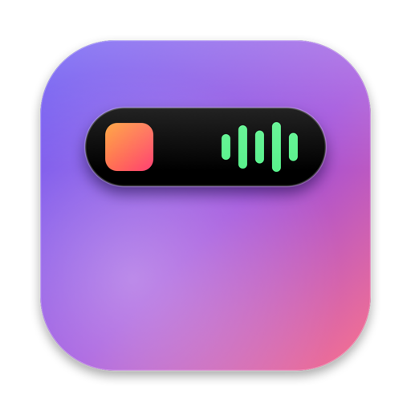

<div align="center">
  
  <h1>DyNotch</h1>
  <p><strong>A Dynamic Island for your MacBook's notch.</strong></p>
  <p>
    
    
    
    
  </p>
  <p>🇪🇸 <a href="README.es.md">Leer en español</a></p>
</div>

---

DyNotch turns the MacBook notch into a Dynamic Island. Hover over it and it opens into widgets: Now Playing, calendar, weather, timers, a file shelf, and more. It also replaces the system volume and brightness HUD, and shows live activities (charging, AirPods, Focus, timers) right beside the notch.

## Install

Download the latest `.dmg` from the [Releases page](https://github.com/juancarloslopez3/DyNotch/releases), open it, and drag **DyNotch** into your Applications folder. Later, **Check for Updates** in Settings › About tells you when a new version is out.

DyNotch is a menu-bar agent: after launch, look for it in the notch and the menu bar, not the Dock. A welcome tour walks you through permissions and has you try the notch on the real thing.

> [!IMPORTANT]
> The app is signed locally rather than with a paid Apple Developer certificate, so macOS blocks the first launch. To allow it: open **System Settings → Privacy & Security**, scroll down to the notice about DyNotch, and click **Open Anyway**. You only need to do this once per version.
>
> For the same reason, macOS stops honouring the **Accessibility** and **Full Disk Access** grants after each update: the switches stay on, but the HUD and Focus status show they need access again. Open **Settings › Permissions** in DyNotch, which clears the stale entry and guides you through allowing it again.

## Features

- **Open it your way** — hover over the notch (or click, your choice in Settings) to open it, or swipe down over it with two fingers; swipe up to close. Swipe left or right with three fingers (or two) to move between tabs. A light trackpad haptic confirms each open.
- **Home tab** — up to three columns of widgets: Now Playing, Clock, Weather, Calendar, Reminders, Battery, and Timer, each large or small and in any order.
- **Layout editor** — Settings › Layout shows a live preview of the notch: drag widgets between columns, onto the tray to remove them and back to add them, move tabs sideways, and right-click a widget to resize it. Hide the tabs you don't use and pick the one it opens on.
- **Now Playing** — works with any app (Music, Spotify, browsers…): artwork, scrubber, play/pause/skip. While music plays, the album art and a waveform sit beside the notch; the waveform moves with the audio actually playing, in a gradient of the cover's colors.
- **Volume & brightness HUD** — replaces the system HUD for volume, display brightness, and keyboard backlight with a notch HUD you can drag. <kbd>⇧⌥</kbd> gives fine steps, and holding <kbd>⌃</kbd> with the brightness keys changes the keyboard backlight (handy on MacBooks without backlight keys).
- **External monitors** — the brightness keys adjust external displays too: Apple's as macOS does, other monitors over DDC/CI (like MonitorControl). They follow the pointer, or adjust every display at once, and Settings › Volume & Brightness has a slider for each display.
- **Calendar & Reminders** — the month at a glance, today circled and dots in your calendars' colors on days with events; click it to turn it over to the week's upcoming events. Tick off today's and overdue reminders.
- **Meeting Join** — Zoom, Meet, Teams, Webex, and FaceTime links in your events are detected, and a *Join* pop-up appears 5 minutes before and at the start.
- **Weather** — current conditions, high/low, and the next hours from Open-Meteo (open license), for your current location or any city you search for.
- **Clock** — large time and date plus up to two world clocks, optionally shown beside the idle notch.
- **Shelf & AirDrop** — drag files toward the notch and drop them on **Shelf** to park them or on **AirDrop** to send them. The Shelf works like a Finder window: select, Quick Look, copy, reorder, drag items back out, share them, or right-click for more.
- **Timers** — timer with presets, stopwatch with laps, and Pomodoro. A ring and countdown sit beside the notch while running. Turn on *Ring until stopped* and it rings like an iPhone timer.
- **Camera mirror** — a quick webcam preview; click to flip between a mirror and how others see you. The camera turns off as soon as the notch closes.
- **Live activities** — charger plugged in or unplugged, low battery, fully charged, Bluetooth devices with their battery, Focus on/off, and Caps Lock. AirPods get a connect animation of their own, with a battery ring for each bud and the case.
- **Two at once** — like the iPhone's Dynamic Island: start a timer while music plays and the music keeps its place beside the notch while the countdown splits off into a bubble of its own, flowing back in when it ends. Click the bubble to open its tab.
- **Every display** — uses the real notch on the built-in display, can draw a virtual notch on external displays, and keeps live activities (timers, music…) over full-screen apps, or hides there if you prefer (HUDs still show).

## Permissions

**Allow All**, in the welcome tour and in Settings › Permissions, asks for each missing permission in turn. Accessibility and Full Disk Access can only be granted in System Settings, so DyNotch opens the right list there with a guide under the window: drag DyNotch's icon onto the list. Any setting that needs a permission says so right under it, with a button to allow it.

| Permission | Used for | Needed? |
|---|---|---|
| Accessibility | Intercepting the volume, brightness, and Caps Lock keys to replace the system HUD | Required for HUDs |
| Calendars, Reminders | Agenda card, meeting Join | Optional |
| Location | Local weather (or pick a city instead) | Optional |
| Camera | Camera mirror tab | Optional |
| Bluetooth | Device connect pop-ups | Optional |
| Notifications | Timer alerts when you're not looking | Optional |
| System Audio Recording | Waveform that moves with the music (otherwise a stand-in animation) | Optional |
| Full Disk Access | Reading Focus status and full access for shelf | Optional |

## Privacy

- **Everything stays on your Mac.** No accounts, no analytics. The only network requests are for weather: your coordinates (or the city name you search for) go to Open-Meteo. **Check for Updates** in Settings › About asks GitHub for the latest release, only when you click it.
- **Nothing is recorded.** The music waveform analyses the system audio into six bands and drops the samples immediately. macOS shows its purple recording dot while the waveform is on screen; turn it off in Settings › Now Playing › *Bars move with the music*.
- **Camera only when you look.** The mirror runs only while it's on screen and stops as soon as the notch closes.

## Gestures & shortcuts

| Action | Shortcut |
|---|---|
| Open the notch | Hover or click · two-finger swipe down |
| Close the notch | Two-finger swipe up |
| Switch tabs | Three-finger swipe left/right (configurable in Settings › Layout) |
| Fine volume / brightness steps | <kbd>⇧⌥</kbd> + volume or brightness keys |
| Keyboard backlight | Hold <kbd>⌃</kbd> + brightness keys (configurable) |
| Shelf: Quick Look (tap to pin, hold to peek) | <kbd>Space</kbd> |
| Shelf: move or extend the selection | <kbd>←</kbd> <kbd>→</kbd> · <kbd>⇧</kbd> + arrows · type a name |
| Shelf: select all · copy | <kbd>⌘A</kbd> · <kbd>⌘C</kbd> |
| Shelf: open | <kbd>⌘O</kbd> · <kbd>⌘↓</kbd> · double-click |
| Shelf: remove | <kbd>⌫</kbd> |

## Building from source

Requires **macOS 26+** and **Xcode 26+** (built and tested on macOS 27 with a MacBook Pro M1 Pro).

```bash
scripts/build.sh             # Release build → /Applications/DyNotch.app, then launches it
scripts/make-dmg.sh          # Release build → build/DyNotch-<version>.dmg, ready for a release
open DyNotch.xcodeproj       # or ⌘R the DyNotch scheme in Xcode
```

Or build and test from the command line:

```bash
xcodebuild -project DyNotch.xcodeproj -scheme DyNotch -destination 'platform=macOS' build
xcodebuild -project DyNotch.xcodeproj -scheme DyNotch test
```

DyNotch can't be distributed on the Mac App Store: it uses private frameworks and a keyboard event tap.

### Keep your permissions across rebuilds

By default the app is signed ad-hoc, so the Accessibility and Full Disk Access grants stop applying every time it's rebuilt. `scripts/build.sh` clears the stale entries for you; after building from Xcode, Settings › Permissions clears them before you drag DyNotch back in. To avoid this altogether:

1. Xcode › Settings › Accounts › add your Apple ID (a free account is enough).
2. Create `Config/Signing.local.xcconfig`:

   ```
   DEVELOPMENT_TEAM = YOUR_TEAM_ID
   CODE_SIGN_IDENTITY = Apple Development
   ```

### Debug remote control

In Debug builds you can drive the notch from the terminal: `swift scripts/notch.swift open timers`, `… swipe` / `… swipe back`, `… hud volume`, `… bt` (`bt max`, `bt late`, `bt off`, `bt mouse`), `… meeting`, `… tour hud` (the welcome tour at a step).

## Architecture

- **Notch window** — a borderless, non-activating `NSPanel` above the menu bar on every Space. A global mouse monitor toggles click-through so the menu bar under it keeps working; the hardware notch is measured from `NSScreen.safeAreaInsets` and `auxiliaryTopLeft/RightArea`.
- **Tab swipes** — two-finger swipes come from scroll events over the open notch. Three-finger swipes are read through the private `MultitouchSupport` framework, only while the notch is open, with no permission needed.
- **Shelf keys** — clicking the Shelf makes its panel key without activating DyNotch (as Spotlight does), so the app in front stays in front while <kbd>Space</kbd>, <kbd>⌘C</kbd>, and the arrows reach the Shelf.
- **HUD** — a `CGEventTap` consumes the media keys so macOS neither changes the level nor shows its HUD. Volume goes through CoreAudio, display brightness through the private `DisplayServices` (built-in and Apple displays), and keyboard backlight through the private `CoreBrightness` `KeyboardBrightnessClient`.
- **DDC/CI** — other monitors take their brightness over DDC/CI, through the private `IOAVService` calls Apple silicon has for each external display. As MonitorControl does, DyNotch finds a display's service in the I/O Registry after its framebuffer and matches it to the screen through CoreDisplay. Monitors on the HDMI port of Macs with an MCDP29xx converter answer at a different address, as m1ddc found. Each monitor has a queue of its own that sends only the newest level, so holding a key or dragging never queues up stale ones.
- **Now Playing** — since macOS 15.4 only entitled processes may read MediaRemote, so DyNotch bundles [mediaremote-adapter](https://github.com/ungive/mediaremote-adapter) (vendored in `Vendor/` at commit `2971825`), which runs through the system `/usr/bin/perl` and streams JSON.
- **Waveform** — a private Core Audio process tap (`CATapDescription`) hears the system mix while the bars are on screen; a 1024-point FFT folds it into six bands, delayed by the output device's latency so they line up with what you hear (AirPods included).
- **Focus** — read from `~/Library/DoNotDisturb/DB`.
- **Permission guide** — a non-activating panel that finds System Settings' window through `CGWindowList` and stays under it. Its icon drags the app's own bundle URL, which the privacy lists accept as a drop; a stale ad-hoc grant is cleared first with `tccutil reset`.
- **AirPods** — the model comes from IOBluetooth's private `productID` getter (so renamed AirPods are still recognised) and the battery from its private `batteryPercent…` getters, with `system_profiler` as the fallback.

## License

DyNotch is released under the [MIT License](LICENSE). It bundles [mediaremote-adapter](https://github.com/ungive/mediaremote-adapter) by Jonas van den Berg, under the BSD-3-Clause license; see [`Vendor/mediaremote-adapter/LICENSE`](Vendor/mediaremote-adapter/LICENSE).

---

<div align="center">Made by <a href="https://github.com/juancarloslopez3">Juan Carlos López</a></div>
